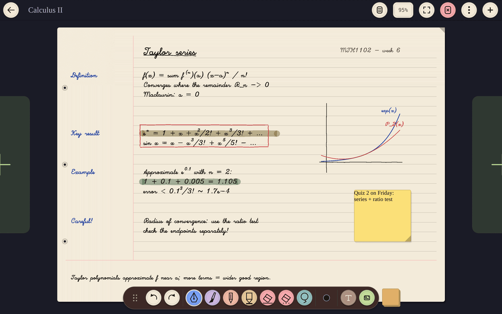
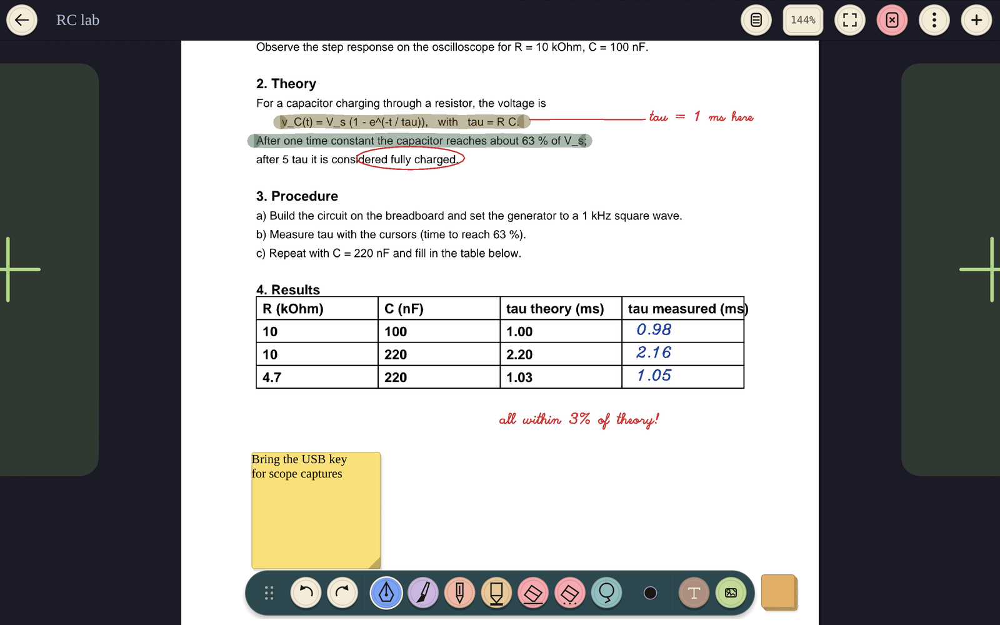
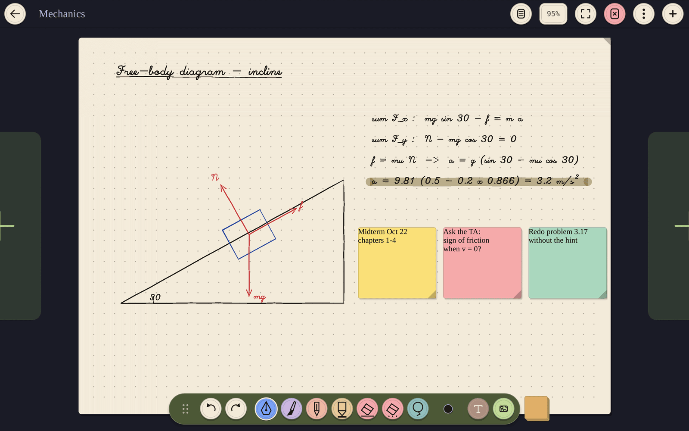
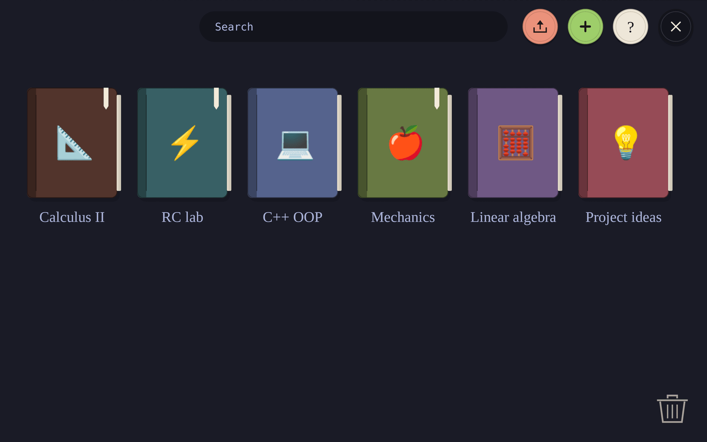

<h1 align="center">Inkarchy</h1>

<p align="center">Native stylus notes for Omarchy, written in Rust.</p>

<p align="center">
  
</p>

## Install

```bash
curl -fsSL https://raw.githubusercontent.com/CloudDown/inkarchy/main/install.sh | bash
```

Uninstall: `curl -fsSL https://raw.githubusercontent.com/CloudDown/inkarchy/main/install.sh | bash -s -- --uninstall`

<table>
  <tr>
    <td width="33%" align="center"><br><sub>Annotate PDFs</sub></td>
    <td width="33%" align="center"><br><sub>Sticky notes</sub></td>
    <td width="33%" align="center"><br><sub>Notebook shelf</sub></td>
  </tr>
</table>

## Usage

Optional **Exercise coach**: use the graduation cap beside the paper style button to connect a local Ollama vision model or Gemini with your own API key. A slim bar shows a qualitative evaluation of handwritten maths and physics steps. Disabled by default; activation is remembered per notebook. [Setup and data handling](docs/GUIDE.md#exercise-coach).

```bash
inkarchy                      # open the shelf
inkarchy ~/Downloads/x.pdf    # open a PDF (or PNG, JPEG, WEBP, SVG, .txt, .md) as a notebook
INKARCHY_OPEN=Physics inkarchy  # open a notebook by title
inkarchy --help               # all commands and gestures
```

| Key | Action |
|---|---|
| `p` `b` `c` `h` | felt-tip, fountain pen, pencil, highlighter |
| `e` / `shift+e` | stroke eraser / area eraser |
| `l` `t` `i` | lasso, text, image |
| `[` `]` · `1-9` | thickness · ink color |
| `m` | cycle paper |
| `+` `-` · `0` | zoom · fit to screen |
| `space` + drag | pan |
| `ctrl+z` / `ctrl+y` | undo / redo |
| `ctrl+o` · `ctrl+s` | open a file · save |
| `ctrl+e` / `ctrl+shift+e` | export PNG / PDF |

<p align="center"><a href="docs/GUIDE.md">Docs</a></p>
